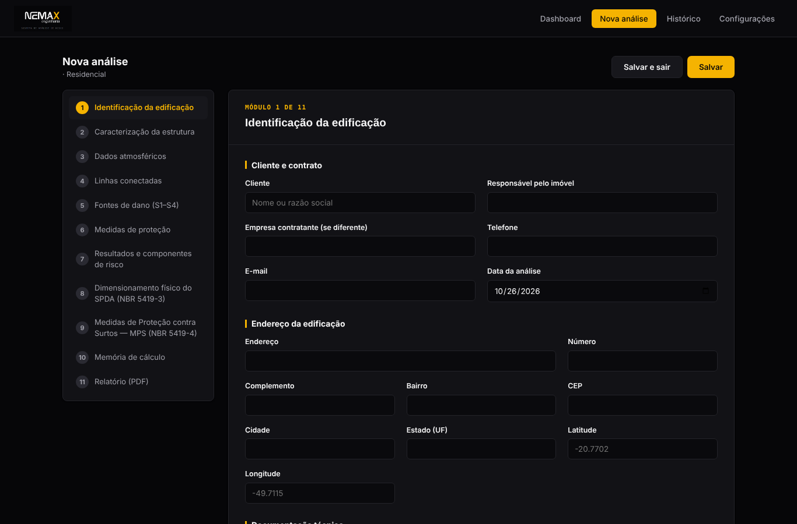
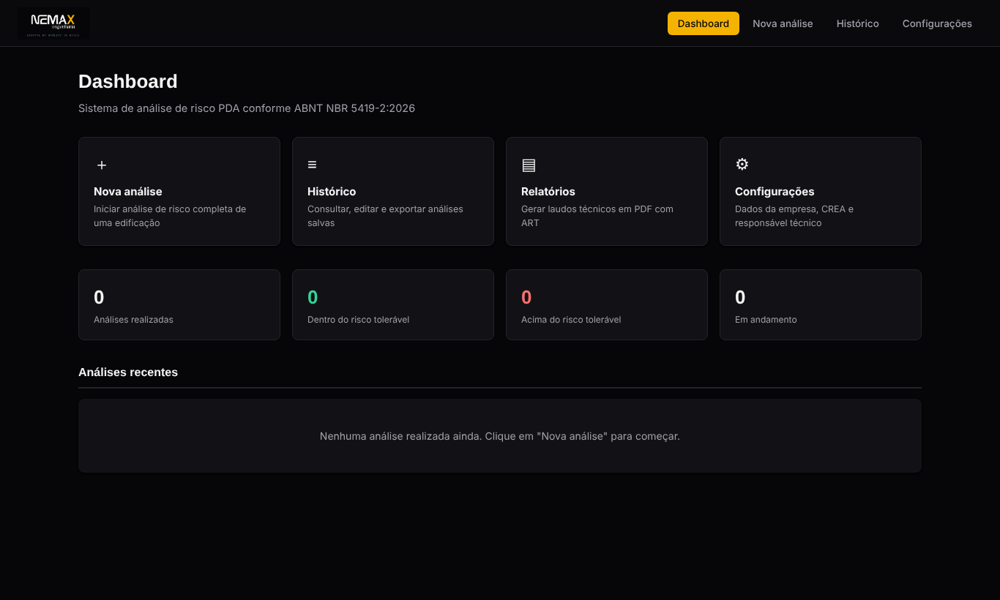
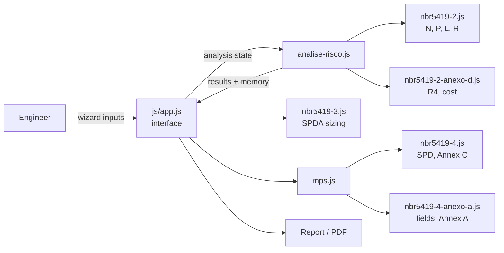

<div align="center">


# ⚡ SPDA Risk Assessment Tool

### Lightning protection risk assessment, SPDA sizing and SPD zoning per ABNT NBR 5419:2026 (Parts 2, 3 and 4)

[](https://itsnetomaset.github.io/spda-risk-assessment-nbr5419/)
[](https://github.com/itsnetomaset/spda-risk-assessment-nbr5419/actions/workflows/ci.yml)


**[▶ Try the live demo](https://itsnetomaset.github.io/spda-risk-assessment-nbr5419/)**

</div>

---

## 📸 Preview

<p align="center">
  
</p>
<p align="center">
  
</p>

---

## 🎯 The Problem

Risk assessment under NBR 5419-2 requires combining dozens of normative tables and structural/environmental parameters into a multi-step probability calculation. Commercial software for this is expensive, generic, and not built around how Brazilian engineers actually move through the standard section by section. Most practitioners fall back on spreadsheets that are error-prone and hard to audit.

## ✅ The Solution

A guided 11-module wizard that walks through the full NBR 5419 workflow: risk assessment per Part 2 (structure characterization through final risk comparison, R ≤ R_T), physical SPDA sizing per Part 3, surge protection measures (MPS) per Part 4, calculation memory and the final PDF report:

| Feature | Description |
|---|---|
| 🗺️ **Automatic N_G lookup** | Lightning flash density for any of Brazil's ~5,570 municipalities, sourced from the standard's official Table F.1 (Annex F) |
| 🧮 **Full calculation engine** | Implements the standard's risk components (R1 to R4) and loss factors |
| 🏗️ **SPDA sizing (Part 3)** | Physical dimensioning of the lightning protection system based on the selected protection level |
| 🔌 **Surge protection (Part 4)** | Lightning protection zones (ZPR 0A, 0B, 1, 2) and SPD (DPS) specification |
| 📑 **Calculation memory** | Step-by-step record of every input, table lookup and intermediate result |
| ✏️ **Auditable manual override** | Any auto-calculated value can be manually adjusted. The original normative value is always preserved |
| 💾 **Offline-first persistence** | Data saved locally via `localStorage`, with JSON export/import |
| 🖨️ **PDF report generation** | Native browser print engine, no server round-trip |

> **Note:** the tool's interface is in Portuguese, as it implements a Brazilian regulatory standard (NBR 5419) for the Brazilian engineering market. Code identifiers and comments inside the engine also follow the standard's Portuguese terminology (for example `calc_distanciaSeguranca`, `L_A`, `P_SPD`), so each line can be checked against the clause it implements. Documentation is in English.

## 🛠️ Tech Stack

Vanilla HTML, CSS and JavaScript. No framework, no build step, no dependencies. The calculation engine is written as native ES modules that run unchanged in the browser and in Node; everything runs client-side.

## 🏗️ Architecture

The engine is separated from the interface. Every normative formula and table lives in `src/engine`, one module per part of the standard, and none of it touches the DOM. The interface reads the user's inputs, calls the engine and renders the results.

```
index.html                      markup and styles
src/
  main.js                       browser entry: imports the engine and exposes it to the interface
  engine/
    nbr5419-2.js                Part 2: Annexes A, B and C (N, P, L), risk components, tolerable risk
    nbr5419-2-anexo-d.js        Part 2, Annex D: economic risk R4 and cost-benefit of protection
    nbr5419-3.js                Part 3: protection angle, earth electrode, down conductors, k_c, separation distance
    nbr5419-4.js                Part 4: protection zones, Tables 1, A.1 and D.1, coordinated SPDs (Annex C)
    nbr5419-4-anexo-a.js        Part 4, Annex A: grid shields, magnetic field, induced loop voltages
    analise-risco.js            complete analysis (R1, R3, F) with its calculation memory, and R4
    mps.js                      SPD points and field evaluations from the surge protection module
    quantitativo-materiais.js   estimated bill of materials for the sized SPDA
    index.js                    single import point (used by the tests)
  data/
    municipios.js               N_G for 5,572 municipalities (Annex F, Table F.1)
js/app.js                       interface: 11-module wizard, persistence, report
test/                           node --test suites and the characterization baseline
```



**Design decisions**

- **Every result carries its source.** Engine functions return `{ value, formula, norma, substituicao }`: the number, the equation, the clause of the standard and the substituted values. The calculation memory and the report are built from these objects, so nothing shown to the client is retyped by hand.
- **The engine has no DOM access.** It takes plain objects and returns plain objects, which is what makes it testable in Node without a browser.
- **ES modules without a build.** The browser loads `src/main.js` as a module; GitHub Pages serves the files as they are, with no bundler and no `node_modules`.
- **The interface kept its global names.** `js/app.js` is a classic script that still refers to `NEMAX_CALC`, `Calculo` and the other engine objects by name. `src/main.js` publishes them on `window`, so the interface did not have to change while the engine moved out.
- **Where the standard gives no closed formula, the tool asks.** Cases resolved graphically in Part 3, Annex C (Figures C.6, C.8 and C.9) take a k_c entered by the engineer instead of an invented approximation.

## 🧪 Tests

```bash
npm test        # runs node --test test/*.test.js (Node 20 or later, nothing to install)
```

Three layers, 148 tests:

- **Normative reference tests** (`test/nbr5419-*.test.js`) check the tables against the normative values transcribed from the standard and every equation against numbers worked out by hand in the test itself, each test named after the clause, table or equation it covers. They include a complete Part 2 analysis of a house computed step by step, with and without an SPDA, and a consistency check showing that the rounded coefficients of Part 4, Eq. (A.27) to (A.42), agree with the general equations derived from μ0 and the front times of Part 1, Table 3.
- **Characterization tests** (`test/characterization.test.js`) run 9 complete analyses, 12 SPD points, 16 field evaluations and sweeps over every engine function, and compare the results with what the original single-file version calculated for the same inputs (see below).
- **Wiring tests** check that `index.html` loads the engine before the interface and that every engine export is published for it.

Introducing small changes on purpose (a coefficient in Eq. (A.6), one point of Figure 1, a value of Table A.1 or of Table F.1) makes the suite fail in every case.

**GitHub Actions** runs the syntax check of the interface script and the full suite on Node 20, 22 and 24 for every push and pull request.

> The text of ABNT NBR 5419 is copyrighted and is not included in this repository. Normative values appear in the code only as the coefficients and tables the calculation needs, each with its clause reference.

## 🔁 How the refactoring was verified

The tool started as a single `index.html` of about 7,300 lines. Before any code moved, a scripted run inside that original file recorded the results of every scenario above (`test/characterization/baseline.json`). The code was then moved one block at a time, in small commits, and after each commit the same run was repeated in headless Chromium.

In Chromium, the refactored app reproduces the original bit for bit: all calculated values, the calculation memory, the HTML of all 11 wizard modules and of the printed report for 10 analyses, with the same console output. In Node, 38 of the recorded numbers differ only in the last bit (at most 4 × 10⁻¹⁶ relative), because Node and Chromium ship different versions of V8 whose `Math.tan`, `Math.cbrt` and `Math.pow` round differently; the characterization tests therefore compare numbers with a relative tolerance of 10⁻¹².

## 🚀 Running locally

Browsers do not load ES modules from `file://` pages, so serve the folder over HTTP instead of opening `index.html` directly:

```bash
python3 -m http.server 8000
# then open http://localhost:8000
```

Any static server works. On GitHub Pages nothing changes: the site is published from the repository as it is.

## 💡 What I Learned

Translating a dense regulatory standard into a deterministic calculation engine meant treating the normative tables as the actual source of truth in code, not paraphrasing them, but encoding them exactly, with traceability back to the specific clause or table they came from. That discipline, and the manual-override-with-audit-trail pattern, came directly from real inspection work in the field, where what the norm says and what the engineer decided both have to stay auditable.

Splitting the single file taught me to pin the current behavior before moving anything. Recording what the tool already calculated, and comparing against it after every small step, let the structure change while every number in the client's report stayed exactly the same.

## 🚧 Roadmap

- [x] Part 3: physical SPDA sizing
- [x] Part 4: surge protection measures and SPD zoning
- [x] Calculation engine in tested ES modules
- [ ] Cross-module validation checks
- [ ] Interactive SVG schematic view
- [ ] Laudo (report) revision history

## 📌 Status

Actively used in real SPDA engineering work.

---

<div align="center">

Built by **[Giuseppe Maset Neto](https://nemaxengenharia.com.br)**, Electrical Engineer (CREA-PR 138473/D)

</div>
